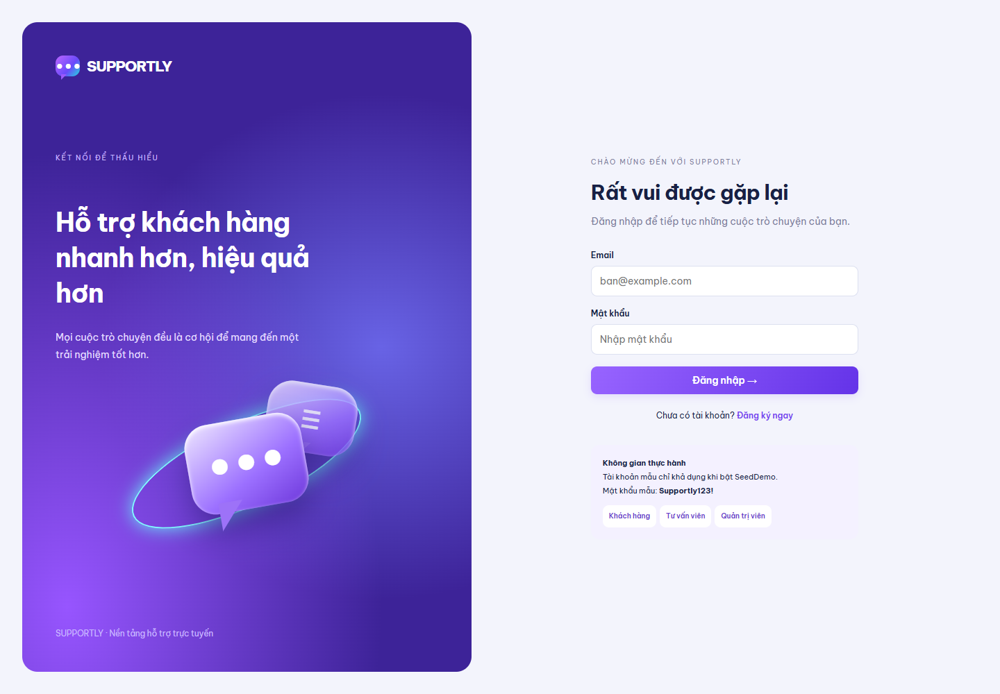
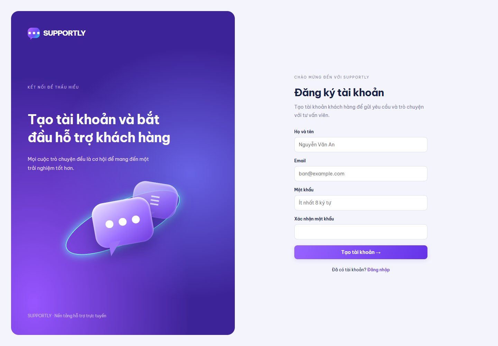
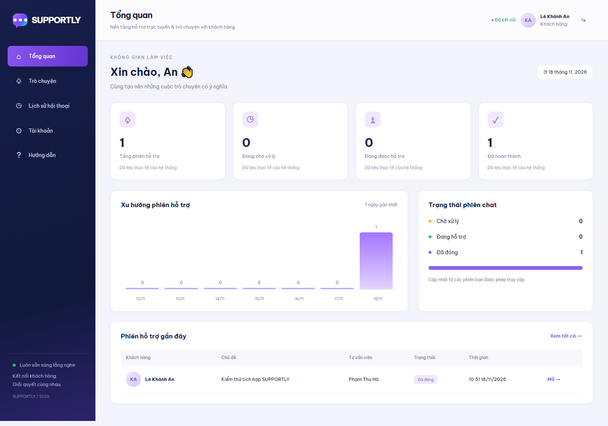
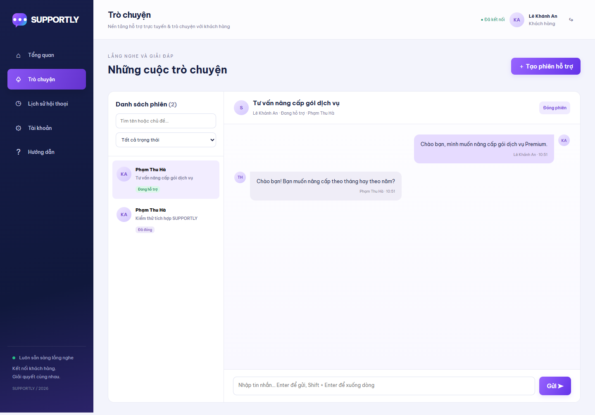
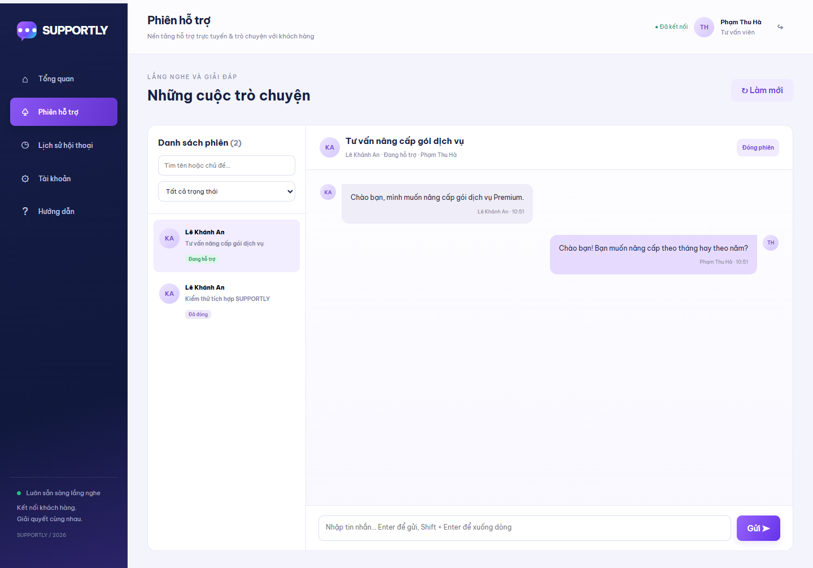
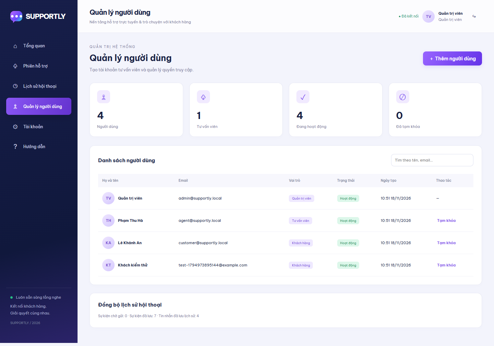

# Báo cáo phát triển hệ thống chat hỗ trợ trực tuyến SUPPORTLY

Môn Phát triển ứng dụng phân tán
Đề tài 16
Kế hoạch 7 tuần từ 18 tháng 11 năm 2026 đến 05 tháng 01 năm 2027

### Mục đích và kết quả

SUPPORTLY hỗ trợ khách hàng và tư vấn viên trao đổi trực tuyến theo từng phiên. Sản phẩm triển khai bằng .NET 10, SignalR, RabbitMQ và một History Worker độc lập, có giao diện tiếng Việt theo hình tham khảo. Mã nguồn, bản chạy Windows, hướng dẫn và minh chứng kiểm thử được bàn giao cùng báo cáo.

Lịch 7 tuần là kế hoạch triển khai và hoàn thiện tính từ ngày 18/11/2026, không phải nhật ký xác nhận đã làm đủ 7 tuần. Kết quả đã chạy ở thời điểm lập báo cáo được trình bày riêng trong phần kiểm thử. Sáu luồng là sáu nhóm công việc; một người có thể đảm nhiệm nhiều luồng khi nhân sự hạn chế.

| Nội dung | Thông tin |
| --- | --- |
| Khoảng thời gian | 18/11/2026 - 05/01/2027, 49 ngày liên tục |
| Sáu luồng | Phân tích; Lập trình; Chạy thử và kiểm thử; Bắt lỗi; Sửa lỗi; Bàn giao sản phẩm và viết báo cáo |
| Thành phần | Supportly.Api, Supportly.Core, Supportly.Worker, RabbitMQ, SQLite |
| Kết quả xác minh | 20 ca tích hợp và 4 ca phục hồi đạt; 7 kiểm tra giao diện Chrome đạt |
| Phạm vi bản chạy | Ứng dụng web cục bộ; hai tiến trình .NET và broker RabbitMQ |

### Cách đọc hồ sơ

Phần phân tích và thiết kế giải thích sản phẩm. Bảy trang kế hoạch tuần nêu rõ việc của từng luồng, đầu ra và tiêu chí hoàn thành. Phần cuối chứa kiểm thử thực tế, lỗi đã sửa, giới hạn, hướng dẫn vận hành và ảnh minh chứng.

## Phân tích yêu cầu và phạm vi

Đề tài yêu cầu tạo phiên hỗ trợ, cho nhân viên tham gia, trao đổi thời gian thực theo nhóm SignalR, phát sự kiện vào RabbitMQ và lưu lịch sử bằng Worker. Phiên đi qua Waiting, Active và Closed. Lịch sử phải tra cứu được qua REST API.

| Mã | Yêu cầu và cách đáp ứng |
| --- | --- |
| FR01 | Khách hàng đăng ký, đăng nhập và tạo phiên hỗ trợ mới ở trạng thái Waiting. |
| FR02 | Tư vấn viên nhận phiên; phép cập nhật có điều kiện ngăn hai người cùng nhận thành công. |
| FR03 | Gửi và nhận tin qua ChatHub, nhóm theo conversationId; máy chủ kiểm tra người tham gia trước khi cho vào nhóm hoặc gửi tin. |
| FR04 | Tin nhắn được ghi cùng outbox trong transaction; publisher nền phát message.sent qua topic exchange. |
| FR05 | History Worker nhận sự kiện, lưu history_events và history_messages rồi mới ack. |
| FR06 | Đóng phiên tạo conversation.closed; máy chủ từ chối tin mới ở trạng thái Closed. |
| FR07 | REST hỗ trợ danh sách, chi tiết, tin nhắn và bản lịch sử; khách chỉ truy cập phiên của mình. |
| FR08 | Quản trị viên thêm khách hoặc tư vấn viên, khóa/mở khóa tài khoản, theo dõi đồng bộ. |

### Yêu cầu chất lượng

Kiểm tra đầu vào ở máy chủ; băm mật khẩu PBKDF2 với salt; token ngẫu nhiên hết hạn sau 12 giờ; SQL có tham số; giao diện escape nội dung tin trước khi hiển thị. UI tự thử kết nối lại, gia nhập lại nhóm và tải tin bền vững để bù khoảng gián đoạn.

### Phạm vi mở rộng sau bàn giao

Chưa có tệp đính kèm, reset mật khẩu qua email, chia ca tự động, tùy biến ma trận quyền, tải lớn hay mở rộng nhiều máy. Quản trị viên xem dữ liệu hệ thống; tư vấn viên xem danh sách/lịch sử hỗ trợ nhưng chỉ gửi tin vào phiên được phân công. Khách hàng chỉ xem dữ liệu của mình.

## Kiến trúc và tổ chức mã nguồn

Customer Client ↔ SignalR Hub trong Supportly.Api ↔ Agent Client
Chat Service → SQLite giao dịch gồm messages và outbox
Outbox Publisher → RabbitMQ → History Worker → SQLite lịch sử

| Thành phần | Trách nhiệm và vị trí |
| --- | --- |
| Supportly.Api | Program.cs: cấu hình, xác thực, REST và ChatHub. OutboxPublisher.cs: gửi sự kiện và chờ publisher confirm. wwwroot: HTML, CSS, JavaScript và thư viện SignalR cục bộ. |
| Supportly.Core | Models.cs: User, Conversation, ChatMessage, ChatEvent. Store.cs: nghiệp vụ, transaction, truy vấn SQL có tham số. Broker.cs: exchange, queue, binding và dead-letter. |
| Supportly.Worker | Program.cs: BackgroundService đọc RabbitMQ, validate hợp đồng, lưu lịch sử và xác nhận thủ công; có HTTP health riêng. |
| SQLite | users, tokens, conversations, messages, outbox, history_events, history_messages. WAL cho hai tiến trình cùng truy cập trên một máy. |
| RabbitMQ | Topic exchange supportly.events, queue durable supportly.history, dead-letter exchange/queue supportly.dead. |

### Độ tin cậy khi gửi và xử lý

Tin được ghi bền trước khi phát realtime. Outbox tồn tại khi broker dừng; publisher chỉ đánh dấu đã gửi sau confirm. Nếu tiến trình chết sau publish nhưng trước đánh dấu, sự kiện có thể được gửi lại. Worker dùng EventId duy nhất trong transaction nên không lưu lặp. MessageId do client tạo giúp máy chủ không ghi trùng một lần gửi lại cùng mã và nội dung.

Worker ack sau commit, nack có requeue và backoff khi ghi database thất bại; JSON hoặc version sai được nack không requeue để vào hàng đợi lỗi. Đây là cơ chế giao nhận ít nhất một lần với xử lý có tính idempotent, không cam kết exactly once ở tầng truyền tải.

### Giới hạn kiến trúc

API và Worker là hai tiến trình độc lập nhưng đang dùng chung SQLite local. Chưa tách database theo service. Nhiều máy cần database server, đồng bộ SignalR và chiến lược vận hành mới; không dùng SQLite trên ổ mạng.

## Sáu luồng công việc và quy trình phối hợp

| Luồng | Nhiệm vụ | Đầu ra bắt buộc |
| --- | --- | --- |
| 1 Phân tích | Xác định vai trò, yêu cầu, API, trạng thái và tiêu chí nghiệm thu. Làm rõ thay đổi trước khi code. | Danh sách yêu cầu, use case, mô hình dữ liệu, API contract và phạm vi. |
| 2 Lập trình | Triển khai API, Hub, giao diện, broker, Worker và đóng gói theo đặc tả. | Mã nguồn chạy được, cấu hình, migration khởi tạo và hướng dẫn. |
| 3 Chạy thử và kiểm thử | Thiết kế dữ liệu, chạy thành công/thất bại, tích hợp, giao diện và phục hồi. | Test case, kết quả thực tế, log, ảnh và kịch bản lặp lại. |
| 4 Bắt lỗi | Tái hiện lỗi, phân loại mức độ, xác định ảnh hưởng và ghi bước tái hiện. | Phiếu lỗi có expected/actual, môi trường, bằng chứng, người nhận. |
| 5 Sửa lỗi | Phân tích nguyên nhân, sửa đúng phạm vi và chuyển bản sửa để kiểm thử lại. | Bản sửa, mô tả nguyên nhân, log kiểm thử lại và hồi quy. |
| 6 Bàn giao và báo cáo | Cập nhật tài liệu liên tục, gom minh chứng, chuẩn bị gói chạy và nghiệm thu. | Báo cáo, bản chạy, source zip, README và biên bản bàn giao. |

### Chu trình một công việc

Luồng 1 chốt tiêu chí → Luồng 2 triển khai → Luồng 3 chạy thử → Luồng 4 ghi và phân loại lỗi → Luồng 5 sửa → Luồng 3 kiểm thử lại → Luồng 6 cập nhật báo cáo và gói bàn giao. Các luồng tiếp tục lặp qua mỗi tuần; báo cáo được viết từ tuần 1.

### Quy tắc ghi nhận

Lỗi Critical gồm mất dữ liệu hoặc truy cập trái phép; High gồm không chat, không nhận phiên hoặc không lưu được lịch sử; Medium gồm sai trạng thái hiển thị, khó phục hồi; Low gồm trình bày. Mỗi lỗi phải có mã, bước tái hiện, kỳ vọng, thực tế, phiên bản, ảnh/log và trạng thái Open, In Progress, Retest hoặc Closed.

Chưa có danh sách nhân sự nên phân công theo vai trò công việc, không tự gán tên hoặc khẳng định đóng góp cá nhân. Khi có thành viên, điền người phụ trách và người kiểm tra chéo vào bảng quản lý nhóm.

## Tuần 1 từ 18 đến 24 tháng 11 năm 2026

Mục tiêu tuần: Chốt yêu cầu và khung hệ thống

| Luồng | Công việc dự kiến | Đầu ra | Tiêu chí hoàn thành |
| --- | --- | --- | --- |
| 1 Phân tích | Đọc đề 16, đối chiếu phụ lục, lập use case ba vai trò và trạng thái phiên. | Đặc tả FR01-FR08, sơ đồ trạng thái. | Mỗi chức năng có tiêu chí đầu vào và đầu ra. |
| 2 Lập trình | Tạo solution ba project, khung REST/Hub và layout theo hình SUPPORTLY. | Solution build được, màn đăng nhập và dashboard. | Không còn project mẫu hoặc route thừa. |
| 3 Kiểm thử | Lập test case, kiểm tra SDK, cổng, health và đường dẫn dữ liệu. | Ma trận môi trường và bộ test ban đầu. | Môi trường có thể dựng lại bằng hướng dẫn. |
| 4 Bắt lỗi | Ghi lỗi cài đặt, restore, thiếu cấu hình và chênh lệch đặc tả. | Danh sách lỗi có bước tái hiện. | Lỗi ngăn build được ưu tiên xử lý. |
| 5 Sửa lỗi | Sửa cấu hình package source, namespace và lỗi khởi tạo. | Bản nền ổn định. | Build và health đạt sau sửa. |
| 6 Bàn giao và báo cáo | Viết mở đầu, mục tiêu, phạm vi và kế hoạch tổng thể. | Báo cáo tuần 1, cây mã nguồn. | Chốt mốc tuần 2 và rủi ro. |

Mốc cuối tuần: đặc tả và kiến trúc được rà soát, chạy được khung API. Rủi ro: thiếu SDK hoặc broker; chuẩn bị cách dựng môi trường trước khi phát triển nghiệp vụ.

### Cách cập nhật tiến độ

Đầu tuần phân công người phụ trách từng đầu ra. Cuối tuần ghi ngày thực hiện, kết quả, mã lỗi liên quan và đường dẫn minh chứng. Nếu trễ mốc, xác định việc chuyển tiếp và ảnh hưởng trước khi bắt đầu tuần sau.

## Tuần 2 từ 25 tháng 11 đến 01 tháng 12 năm 2026

Mục tiêu tuần: Hoàn thành tài khoản và quản lý phiên

| Luồng | Công việc dự kiến | Đầu ra | Tiêu chí hoàn thành |
| --- | --- | --- | --- |
| 1 Phân tích | Chốt xác thực, phân quyền, dữ liệu người dùng và hợp đồng phiên. | API contract và mô hình bảng. | Khách không được tự nhận vai trò Agent/Admin. |
| 2 Lập trình | Viết đăng ký, đăng nhập, token, tạo/liệt kê phiên và nhận phiên. | Luồng Waiting → Active, giao diện tài khoản. | Nhận phiên dùng cập nhật nguyên tử. |
| 3 Kiểm thử | Thử email trùng, mật khẩu sai, truy cập chéo và nhận phiên lặp. | Test tài khoản, phiên và quyền. | 400/401/403/409 đúng trường hợp. |
| 4 Bắt lỗi | Tái hiện lỗi kiểm tra đầu vào, lộ danh sách hoặc nhận trùng. | Phiếu lỗi kèm request/response. | Phân loại rõ ảnh hưởng đến dữ liệu. |
| 5 Sửa lỗi | Sửa validate, truy vấn theo chủ sở hữu và điều kiện chuyển trạng thái. | Bản vá nghiệp vụ tài khoản/phiên. | Chạy lại cả ca hợp lệ và ca thất bại. |
| 6 Bàn giao và báo cáo | Viết thiết kế dữ liệu và hướng dẫn tài khoản thực hành. | Báo cáo tuần 2, ảnh và log. | Đặc tả khớp route đã triển khai. |

Mốc cuối tuần: ba vai trò đăng nhập được; khách tạo phiên và tư vấn viên nhận phiên. Rủi ro: tranh chấp khi nhận đồng thời; kiểm chứng điều kiện cập nhật trong database.

### Cách cập nhật tiến độ

Đầu tuần phân công người phụ trách từng đầu ra. Cuối tuần ghi ngày thực hiện, kết quả, mã lỗi liên quan và đường dẫn minh chứng. Nếu trễ mốc, xác định việc chuyển tiếp và ảnh hưởng trước khi bắt đầu tuần sau.

## Tuần 3 từ 02 đến 08 tháng 12 năm 2026

Mục tiêu tuần: Hoàn thành chat thời gian thực

| Luồng | Công việc dự kiến | Đầu ra | Tiêu chí hoàn thành |
| --- | --- | --- | --- |
| 1 Phân tích | Chốt phương thức Hub, sự kiện client và quy tắc tham gia nhóm. | Contract Join/Leave/Send và realtime events. | ConnectionId không thay cho danh tính. |
| 2 Lập trình | Viết ChatHub, group theo phiên, tin bền vững và giao diện hai phía. | Chat khách/tư vấn viên, chống lưu trùng mã tin. | Chỉ người tham gia gửi được. |
| 3 Kiểm thử | Chạy hai vai trò và khách ngoài phiên, tin rỗng, dài, trùng và đóng phiên. | Minh chứng SignalR cùng/khác nhóm. | Hai bên nhận đúng; ngoài nhóm không nhận. |
| 4 Bắt lỗi | Theo dõi sai group, callback trùng, sai thứ tự và UI thiếu cập nhật. | Phiếu lỗi realtime có thời điểm và mã phiên. | Tái hiện được trên hai cửa sổ. |
| 5 Sửa lỗi | Sửa kiểm tra membership, escape nội dung, idempotency và cập nhật UI. | Bản chat ổn định. | Không lặp dữ liệu và không chèn HTML. |
| 6 Bàn giao và báo cáo | Viết đường đi tin nhắn, group và ảnh khách/tư vấn viên. | Báo cáo tuần 3 và kịch bản demo. | Ảnh gắn với hành động và kết quả. |

Mốc cuối tuần: chat hai chiều đúng phạm vi phiên. Rủi ro: reconnect làm mất nhóm; thiết kế gia nhập lại nhóm và tải bù từ REST.

### Cách cập nhật tiến độ

Đầu tuần phân công người phụ trách từng đầu ra. Cuối tuần ghi ngày thực hiện, kết quả, mã lỗi liên quan và đường dẫn minh chứng. Nếu trễ mốc, xác định việc chuyển tiếp và ảnh hưởng trước khi bắt đầu tuần sau.

## Tuần 4 từ 09 đến 15 tháng 12 năm 2026

Mục tiêu tuần: Tích hợp RabbitMQ và History Worker

| Luồng | Công việc dự kiến | Đầu ra | Tiêu chí hoàn thành |
| --- | --- | --- | --- |
| 1 Phân tích | Chốt hợp đồng sự kiện, EventId, version, queue và giao nhận. | Sơ đồ outbox, broker và Worker. | Phân biệt realtime với xử lý hậu kỳ. |
| 2 Lập trình | Viết outbox transaction, publisher confirm, consumer, ack và history API. | Sự kiện message.sent/conversation.closed, bản lịch sử. | Ack chỉ sau khi lưu bền. |
| 3 Kiểm thử | Thử lưu lịch sử, gửi event trùng, JSON sai, tắt/bật broker. | Log publisher/consumer và hàng đợi lỗi. | Phục hồi không mất event đã commit. |
| 4 Bắt lỗi | Ghi lỗi routing, mất event, ack sớm, lặp dữ liệu và retry dồn dập. | Phiếu lỗi tích hợp có EventId. | Truy vết từ outbox đến database lịch sử. |
| 5 Sửa lỗi | Sửa retry/backoff, transaction khử trùng và cấu hình durable. | Bản sửa tính tin cậy. | Ca lỗi và ca hồi quy đều đạt. |
| 6 Bàn giao và báo cáo | Viết kiến trúc phân tán, eventual consistency và giới hạn SQLite. | Báo cáo tuần 4, sơ đồ và log. | Giải thích đúng at-least-once. |

Mốc cuối tuần: Worker lưu lịch sử qua RabbitMQ thật. Rủi ro: publish lại khi mất confirm; dùng EventId duy nhất và xử lý idempotent.

### Cách cập nhật tiến độ

Đầu tuần phân công người phụ trách từng đầu ra. Cuối tuần ghi ngày thực hiện, kết quả, mã lỗi liên quan và đường dẫn minh chứng. Nếu trễ mốc, xác định việc chuyển tiếp và ảnh hưởng trước khi bắt đầu tuần sau.

## Tuần 5 từ 16 đến 22 tháng 12 năm 2026

Mục tiêu tuần: Kiểm thử tích hợp và quản trị

| Luồng | Công việc dự kiến | Đầu ra | Tiêu chí hoàn thành |
| --- | --- | --- | --- |
| 1 Phân tích | Rà soát yêu cầu còn thiếu, vai trò Admin và tiêu chí nghiệm thu. | Ma trận yêu cầu → chức năng → test. | Không bổ sung phạm vi chưa thống nhất. |
| 2 Lập trình | Hoàn thiện thống kê dữ liệu thật, quản lý người dùng, lọc và lịch sử. | Dashboard, thêm/khóa tài khoản, UI responsive. | Thống kê khớp dữ liệu truy vấn. |
| 3 Kiểm thử | Chạy trọn bộ tích hợp, UI desktop/mobile và kiểm tra lỗi JavaScript. | Kết quả JSON và ảnh từng màn hình. | Không tràn ngang ở 390 px. |
| 4 Bắt lỗi | Tổng hợp lỗi dùng thử, thiếu trạng thái, lỗi quyền và dữ liệu sai. | Backlog ưu tiên theo Critical/High/Medium/Low. | Mỗi lỗi có expected và actual. |
| 5 Sửa lỗi | Sửa lỗi nghiêm trọng trước; kiểm thử lại màn hình bị ảnh hưởng. | Bản sửa có bằng chứng trước/sau. | Không còn lỗi truy cập chéo hoặc mất tin. |
| 6 Bàn giao và báo cáo | Hoàn thiện chương kết quả, bảng test và danh sách lỗi. | Báo cáo tuần 5, bộ minh chứng có tên rõ. | Tách kết quả thực tế khỏi kỳ vọng. |

Mốc cuối tuần: quy trình nghiệp vụ end-to-end đạt. Rủi ro: dữ liệu test làm nhiễu thống kê; dùng môi trường dữ liệu thực hành riêng.

### Cách cập nhật tiến độ

Đầu tuần phân công người phụ trách từng đầu ra. Cuối tuần ghi ngày thực hiện, kết quả, mã lỗi liên quan và đường dẫn minh chứng. Nếu trễ mốc, xác định việc chuyển tiếp và ảnh hưởng trước khi bắt đầu tuần sau.

## Tuần 6 từ 23 đến 29 tháng 12 năm 2026

Mục tiêu tuần: Ổn định phiên bản và chuẩn bị bàn giao

| Luồng | Công việc dự kiến | Đầu ra | Tiêu chí hoàn thành |
| --- | --- | --- | --- |
| 1 Phân tích | Chốt phạm vi phiên bản 1 và danh sách giới hạn chấp nhận được. | Checklist release và tiêu chí đóng lỗi. | Không còn chức năng bắt buộc chưa đối chiếu. |
| 2 Lập trình | Publish Windows, hoàn thiện Compose, launcher và hướng dẫn vận hành. | Gói phần mềm và gói mã nguồn. | Không kèm token hoặc dữ liệu người dùng. |
| 3 Kiểm thử | Dựng từ gói sạch, kiểm tra cổng, database, health và phục hồi. | Biên bản kiểm thử cài đặt và hồi quy. | Người khác chạy theo README được. |
| 4 Bắt lỗi | Ghi lỗi chỉ xuất hiện khi đóng gói hoặc khác môi trường. | Danh sách lỗi release với log cài đặt. | Ưu tiên lỗi không khởi chạy được. |
| 5 Sửa lỗi | Sửa đường dẫn, cấu hình runtime, thiếu asset và lỗi khởi chạy. | Release candidate đã kiểm tra lại. | Không phát sinh hồi quy nghiệp vụ. |
| 6 Bàn giao và báo cáo | Chỉnh báo cáo, ảnh, mục lục hồ sơ và kịch bản thuyết trình. | Báo cáo gần hoàn chỉnh, release notes. | Mọi minh chứng dẫn đúng tệp. |

Mốc cuối tuần: có release candidate và hướng dẫn tái lập. Rủi ro: máy nhận thiếu runtime hoặc Docker; nêu rõ điều kiện và kiểm tra health.

### Cách cập nhật tiến độ

Đầu tuần phân công người phụ trách từng đầu ra. Cuối tuần ghi ngày thực hiện, kết quả, mã lỗi liên quan và đường dẫn minh chứng. Nếu trễ mốc, xác định việc chuyển tiếp và ảnh hưởng trước khi bắt đầu tuần sau.

## Tuần 7 từ 30 tháng 12 năm 2026 đến 05 tháng 01 năm 2027

Mục tiêu tuần: Nghiệm thu và gửi sản phẩm

| Luồng | Công việc dự kiến | Đầu ra | Tiêu chí hoàn thành |
| --- | --- | --- | --- |
| 1 Phân tích | Đối chiếu lần cuối tám yêu cầu với tiêu chí nghiệm thu. | Bảng nghiệm thu, phạm vi hoàn thành và tồn tại. | Giải thích được mọi chênh lệch. |
| 2 Lập trình | Đóng băng tính năng, chỉ cập nhật cấu hình hoặc lỗi chặn bàn giao. | Phiên bản bàn giao thống nhất. | Source và bản chạy cùng phiên bản. |
| 3 Kiểm thử | Chạy demo cuối ba vai trò, kiểm tra lịch sử và bộ kiểm thử bắt buộc. | Log cuối, ảnh cuối, kết quả pass/fail. | Không còn lỗi Critical hoặc High mở. |
| 4 Bắt lỗi | Rà soát lỗi chưa đóng và lỗi phát hiện trong nghiệm thu. | Danh sách tồn tại có mức độ và tác động. | Không che giấu lỗi chưa xác minh. |
| 5 Sửa lỗi | Sửa lỗi chặn, chạy lại hồi quy và xác nhận với người kiểm thử. | Bản cuối và phiếu lỗi Closed/Deferred. | Không sửa tùy tiện sau khi chốt gói. |
| 6 Bàn giao và báo cáo | Gom gói chạy, source, báo cáo, test, ảnh; gửi qua kênh được chỉ định. | Hồ sơ bàn giao cuối và xác nhận tiếp nhận. | Hoàn tất trước hết ngày 05/01/2027. |

Mốc cuối tuần: nghiệm thu và bàn giao hồ sơ. Việc gửi ra ngoài chỉ thực hiện khi có nơi nhận và kênh nộp cụ thể; gói hồ sơ cục bộ đã được chuẩn bị.

### Cách cập nhật tiến độ

Đầu tuần phân công người phụ trách từng đầu ra. Cuối tuần ghi ngày thực hiện, kết quả, mã lỗi liên quan và đường dẫn minh chứng. Nếu trễ mốc, xác định việc chuyển tiếp và ảnh hưởng trước khi bắt đầu tuần sau.

## Kết quả kiểm thử thực tế

Các kiểm thử dưới đây đã được chạy trong môi trường thực hành khi lập hồ sơ, độc lập với lịch dự kiến 7 tuần. Môi trường gồm .NET SDK 10.0.300-preview.0.26177.108, Windows, Chrome headless, RabbitMQ container và SQLite. Build cuối không có warning hoặc error.

| Mã | Nội dung kiểm thử | Kết quả |
| --- | --- | --- |
| TC01 | Health API trả thành công | Đạt |
| TC02 | Chưa đăng nhập bị từ chối | Đạt |
| TC03 | Đăng nhập đủ ba vai trò | Đạt |
| TC04 | Mật khẩu sai bị từ chối | Đạt |
| TC05 | Đăng ký Customer và chống email trùng | Đạt |
| TC06 | Khách không quản lý người dùng | Đạt |
| TC07 | Kiểm tra độ dài chủ đề | Đạt |
| TC08 | Tạo phiên Waiting | Đạt |
| TC09 | Cách ly truy cập REST của khách | Đạt |
| TC10 | Xác thực và phân nhóm SignalR | Đạt |
| TC11 | Nhận phiên và từ chối nhận lặp | Đạt |
| TC12 | Chat hai chiều, ngoài nhóm không nhận | Đạt |
| TC13 | Chống ghi trùng MessageId | Đạt |
| TC14 | Từ chối tin rỗng | Đạt |
| TC15 | Người ngoài không gửi được | Đạt |
| TC16 | Đóng phiên và từ chối tin mới | Đạt |
| TC17 | Worker lưu lịch sử từ RabbitMQ | Đạt |
| TC18 | Cách ly API lịch sử | Đạt |
| TC19 | Khóa và mở khóa tài khoản | Đạt |
| TC20 | Logout thu hồi token | Đạt |
| TC21 | Broker dừng, outbox giữ sự kiện | Đạt |
| TC22 | Broker phục hồi, outbox tự gửi lại | Đạt |
| TC23 | EventId trùng chỉ lưu một lần | Đạt |
| TC24 | JSON lỗi vào dead-letter queue | Đạt |

Bảy kiểm tra trình duyệt: đăng nhập/tổng quan; tạo và nhận phiên/chat hai chiều; quản lý người dùng; đóng phiên; xem lịch sử Worker; mobile 390 px không tràn ngang; không có lỗi JavaScript. Bằng chứng: integration-results.json, resilience-results.json, browser-results.json và các PNG trong output/evidence.

## Lỗi đã xử lý và nghiệm thu

| Mã | Vấn đề thực tế | Cách xử lý và xác minh |
| --- | --- | --- |
| BUG01 | NuGet kế thừa nguồn local không tồn tại, restore thất bại. | Thêm NuGet.Config cấp dự án, clear nguồn cũ và dùng nuget.org; restore/build lại đạt. |
| BUG02 | Lambda ReceivedAsync dùng tham số _ làm out _ sai kiểu khi TryParse GUID. | Đổi tên tham số callback; Worker biên dịch thành công. |
| BUG03 | Phụ thuộc SQLite native cũ có cảnh báo bảo mật. | Nâng Microsoft.Data.Sqlite lên 10.0.15, bundle_e_sqlite3 3.0.5; build không còn cảnh báo. |
| BUG04 | Tiêu đề chat còn trạng thái chờ sau khi tư vấn viên nhận phiên. | Cập nhật phần metadata theo ConversationChanged, không xóa nội dung đang soạn. |
| BUG05 | Khung chat cao hơn vùng hiển thị desktop. | Điều chỉnh chiều cao theo header và khoảng cách; chạy lại kiểm tra trình duyệt. |
| BUG06 | Biểu thức selector bị shell nội suy khi sửa JavaScript. | Sửa bằng thao tác tệp trực tiếp, node --check và kiểm thử Chrome lại. |
| ENV01 | Hết dung lượng đĩa trong quá trình tạo gói. | Dọn cache và thư viện phân tích không dùng do tác vụ tạo; kiểm tra lại tệp và gói trước bàn giao. |

### Tiêu chí nghiệm thu phiên bản thực hành

Tạo phiên Waiting; tư vấn viên nhận thành Active; chat đúng người tham gia; lưu dữ liệu bền; phát và xử lý sự kiện qua RabbitMQ; đóng thành Closed; đọc được lịch sử qua REST; quyền khách hàng được cách ly; có bản chạy và hướng dẫn. Các tiêu chí chức năng này đã được đối chiếu bằng bộ kiểm thử thực tế.

### Nội dung chưa xác minh

Chưa kiểm thử tải lớn, nhiều API instance, thời gian ngừng dài, máy nhận hoàn toàn mới hoặc triển khai Internet. Hai Dockerfile đã chuẩn bị nhưng chưa chạy toàn bộ API/Worker trong container. Không suy diễn những khả năng này từ việc broker container đang hoạt động.

## Vận hành và hồ sơ bàn giao

### Cách khởi chạy bản Windows

Cài .NET 10 ASP.NET Core Runtime hoặc SDK và Docker Desktop. Giải nén Supportly-App.zip, mở Docker Desktop rồi chạy START-SUPPORTLY.cmd. Bộ khởi chạy mở broker, API và Worker, sau đó mở http://localhost:5080. STOP-SUPPORTLY.cmd chỉ dừng API/Worker do bộ khởi chạy ghi nhận; RabbitMQ được giữ để bảo toàn hàng đợi.

| Vai trò | Email thực hành | Mật khẩu |
| --- | --- | --- |
| Khách hàng | customer@supportly.local | Supportly123! |
| Tư vấn viên | agent@supportly.local | Supportly123! |
| Quản trị viên | admin@supportly.local | Supportly123! |

Các tài khoản mẫu chỉ dùng trong môi trường thực hành khi SeedDemo=true. Dữ liệu bản chạy nằm trong thư mục data. Cổng 5080 cho API, 5081 cho Worker, 5672 cho AMQP và 15672 cho quản trị RabbitMQ. Worker health trả 503 khi chưa kết nối broker; API health chạy không đồng nghĩa lịch sử đã đồng bộ.

### Kịch bản trình diễn nghiệm thu

Mở hai cửa sổ riêng cho khách và tư vấn viên. Khách tạo yêu cầu và gửi tin, tư vấn viên nhận phiên và trả lời. Đóng phiên, thử gửi thêm và xác nhận bị chặn. Chuyển sang lịch sử để xem bản lưu Worker. Đăng nhập Admin, kiểm tra thống kê, tạo tư vấn viên, khóa/mở khóa tài khoản thử nghiệm.

| Hồ sơ | Nội dung |
| --- | --- |
| Supportly-App.zip | Bản publish Windows framework-dependent, launcher, Compose và hướng dẫn. |
| Supportly-Source.zip | Mã nguồn ba project, giao diện, cấu hình, tests, README và báo cáo. |
| Báo cáo PDF và Markdown | Phân tích, kiến trúc, kế hoạch 7 tuần, 6 luồng, kết quả thật và giới hạn. |
| output/evidence | Ảnh màn hình và JSON kết quả kiểm thử; không phải dữ liệu sản xuất. |

### Tài liệu tham khảo

1. Đề tài 16 Hệ thống chat hỗ trợ trực tuyến, PDF người dùng cung cấp, 2 trang.
2. Phụ lục Hướng dẫn thực hành Phát triển ứng dụng phân tán, 54 trang; tham khảo các bài Minimal API, SignalR, RabbitMQ và Docker.
3. Microsoft Learn: ASP.NET Core SignalR JavaScript client, https://learn.microsoft.com/aspnet/core/signalr/javascript-client
4. RabbitMQ: .NET Client API Guide, https://www.rabbitmq.com/client-libraries/dotnet-api-guide

## Minh chứng đăng nhập và đăng ký

Đăng nhập theo thiết kế SUPPORTLY

Đăng ký tài khoản khách hàng

## Minh chứng tổng quan và trò chuyện

Tổng quan với dữ liệu thực tế

Khách hàng nhận và gửi tin thời gian thực

## Minh chứng tư vấn viên và quản trị

Tư vấn viên xử lý phiên được phân công

Quản trị viên quản lý người dùng

